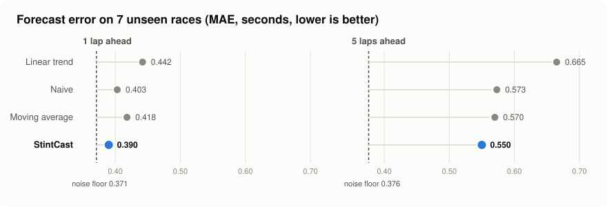

# StintCast

StintCast forecasts Formula 1 lap times one to five laps ahead, with an 80% prediction interval on every forecast. It is evaluated by replaying real races lap by lap, using only the information that was available at each moment.

<p align="center">
  
</p>

## Results

On the last 7 races of the 2024 season (6,381 laps, not used for training or tuning):

| | 1 lap ahead | 5 laps ahead |
|---|---|---|
| Naive (last lap time) | 0.403 s | 0.573 s |
| Moving average, 3 laps | 0.418 s | 0.570 s |
| Linear trend | 0.442 s | 0.665 s |
| StintCast | 0.390 s | 0.550 s |
| Coverage of the 80% intervals | 78.7% | 80.4% |

- **Per race:** the model beats the best baseline in 5 of the 7 test races.
- **Noise floor:** a smooth curve fitted on the whole stint, including the laps that come later, still has an error of 0.371 s one lap ahead. No method based on the pace can go below this, and the model is 0.02 s above it. Five laps ahead the gap is 0.17 s, and it comes from pace changes that the previous laps do not show, such as traffic.

## How it works

**Data.** Laps, stints, pit stops and race control messages for the 2023 and 2024 seasons come from [OpenF1](https://openf1.org). The cleaning step removes laps that do not reflect the race pace:

- the first lap;
- pit in-laps and out-laps;
- laps under safety car or VSC, and the lap after the restart;
- wet-weather laps;
- laps slower than 107% of the stint median.

21,453 of the 26,629 laps of 2024 are kept.

**Model.** A linear regression for each horizon. It predicts the change from the current pace, the average of the last three laps, instead of the lap time itself, so the same model works on circuits with very different lap times. It uses eight features:

- tyre age;
- lap number, as a proxy for fuel;
- compound;
- the last lap compared to the current pace;
- the slope of the recent laps;
- how much the tyres degraded on the same circuit in 2023;
- how much they have degraded so far in the current race.

**Intervals.** Split conformal prediction, calibrated on races that are not used to train the model. It wraps any forecaster, so the baselines can get intervals too.

**Evaluation.** Races are split chronologically: the first 16 for training and the last 7 for testing. Within a race, a feature can only use laps that had finished before the current lap ended, checked with timestamps. Every forecaster implements the same interface and goes through the same replay, so the comparison is on identical cases:

```java
double forecast(List<CleanLap> history, int horizon);
```

**What did not work.**
- **Huber fit:** a robust fit gave the same error as least squares, so least squares is kept.
- **Pit window:** suggesting a pit window from the forecasts matched the real stop in fewer than 1 in 5 cases. Stop timing depends on rivals and race strategy, not only on degradation, so the forecasts are presented as information and the decision is left to the strategist.

## Running

Requires Java 21 and Maven.

```bash
git clone https://github.com/sk-ix/stintcast.git
cd stintcast
mvn test
mvn compile exec:java -Dexec.mainClass=io.github.skix.stintcast.Main
```

The first run downloads both seasons from OpenF1 and saves them in `data/`. The program prints the results of all the experiments.

## Structure

```
src/main/java/io/github/skix/stintcast/
├── client/        OpenF1 HTTP client
├── model/         records for laps, stints, pit stops and clean laps
├── pipeline/      cleaning rules, season loading, stint replay
├── storage/       CSV export and import
├── forecast/      Forecaster interface and conformal intervals
│   ├── baseline/      naive, moving average, linear trend
│   └── regression/    features, track history, race degradation, model
├── evaluation/    chronological split, backtesting, noise floor
└── strategy/      pit stop detection and pit window experiment
```

## Next steps

- Tyre status: tyre age compared to the usual stop, expected time loss with its interval
- REST API with an OpenAPI contract
- Logging of every prediction with the model version
- Live accuracy monitoring and a web dashboard
- Docker

## Built with

Java 21, Maven, Jackson, Apache Commons Math, JUnit 5.

## Data

Race data from [OpenF1](https://openf1.org), licensed under [CC BY-NC-SA 4.0](https://creativecommons.org/licenses/by-nc-sa/4.0/). This is an unofficial project, not associated with Formula 1, the FIA or Formula One Management.
